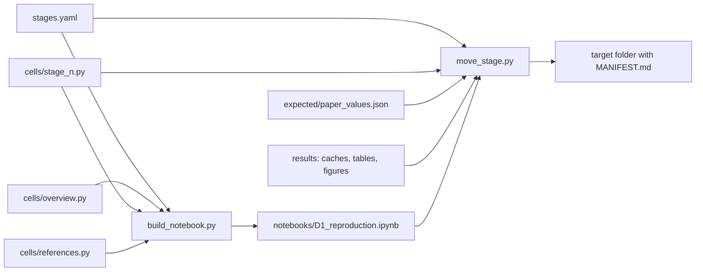
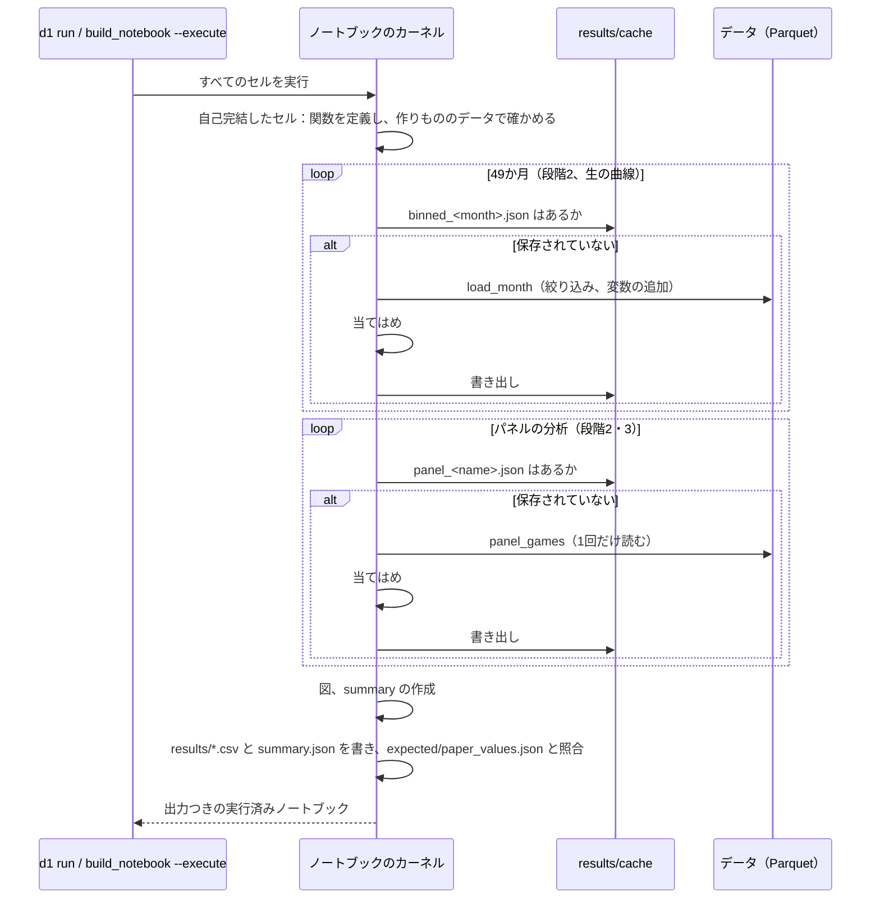

# 構成

> English version (primary): [architecture.md](architecture.md)

分析のコードは、すべてノートブック [notebooks/D1_reproduction.ipynb](../notebooks/D1_reproduction.ipynb) の中にある。どの数値も1か所で監査できるようにするためである。ノートブックは、[scripts/cells/](../scripts/cells) のセルのモジュールから、[scripts/build_notebook.py](../scripts/build_notebook.py) が [stages.yaml](../stages.yaml) の順に作る。編集するのはセルのモジュールである。パッケージ `lichess_d1` には、分析でないものだけを置く：データの場所、図の体裁、ノートブックを実行するコマンド。

## ファイル

| ファイル | 役割 |
|---|---|
| `scripts/cells/overview.py`、`stage_<n>.py`、`references.py` | ノートブックの元：すべてのマークダウンのセル（日本語のみ）とすべてのコードのセル（英語のみ）を、リスト `CELLS` として持つ。各段階のモジュールの docstring に、前の段階から使う名前を書く |
| `scripts/cells/common.py` | セルを作る関数 `md()` と `code()`、`self-contained` の札 |
| `stages.yaml` | ノートブックの段階の順（下を参照） |
| `scripts/build_notebook.py` | 概要、`stages.yaml` の順の各段階のモジュール、参考文献をつないでノートブックを作る。`--execute` で実行もする |
| `scripts/stage_list.py` | 下の2つのスクリプトのために `stages.yaml` を読む（`Stage`、`load_stages()`） |
| `scripts/move_stage.py` | 1つの段階をそのファイルとともに別のフォルダへ写す。または外す（下を参照） |
| `notebooks/D1_reproduction.ipynb` | 作られて実行されたノートブック：すべての分析のコードとその出力 |
| `src/lichess_d1/config.py` | データの場所（環境変数 `D1_*`）、ノートブックの場所、論文の数値の一覧の場所 |
| `src/lichess_d1/plotting.py` | 図の体裁：決まった配色、控えめな軸、`new_figure`、`save_figure` |
| `src/lichess_d1/cli.py` | `d1 run [--refresh]`：ノートブックをその場で実行する |
| `tests/test_notebook.py` | ノートブックの自己完結したセルを実行し、論文のすべての数値が再現されたかを確かめる |
| `tests/test_move_stage.py` | 作りもののリポジトリの構成で `move_stage.py` を確かめる。各段階のモジュールが前の段階から使う名前を書いているかも確かめる |
| `expected/paper_values.json` | 論文に書いたすべての数値と、それが `summary` のどこにあるか |

## 段階（`stages.yaml`）

`stages.yaml` の各項目は、ノートブックの1つの段階であり、ノートブックの順に並ぶ。

| キー | 意味 |
|---|---|
| `id` | 段階の番号（ノートブックの見出しと同じ） |
| `title_ja` | ノートブックでの段階の見出し |
| `module` | セルのモジュール `scripts/cells/stage_<n>.py` |
| `questions` | 答える問いの番号（`Q2a` など） |
| `caches` | `results/cache` にある、保存した当てはめのグロブ |
| `results` | `results` にある表のグロブ |
| `figures` | `results/figures` にある図のグロブ |
| `summary_key` | `summary.json` でのキー。なければ null |
| `expected_prefix` | `expected/paper_values.json` での数値の経路の接頭辞、またはその一覧（段階3は Binscatter の `panel.flexible` の経路も持つ）。なければ null |

`move_stage.py <id> --to <dir>` は、実行済みのノートブック、段階のモジュール、照合する数値（同じ書き方の `paper_values.json`）、`stages.yaml` の項目、当てはまる保存した当てはめ・表・図を、同じ相対パスで `<dir>` に写し、`<dir>/MANIFEST.md` に、何を写したか、どのコミットからか、どう戻すかを書く。`<dir>` はリポジトリの外にあり、これらのファイルをまだ持たないフォルダにする。`--dry-run` はこの計画を表示するだけである。`--remove` は、コミットしていない変更があれば動かない。先に今のコミットに `pre-move-stage<id>-<YYYYMMDD>` のタグ（その名のタグが別のコミットにあれば `-2`、`-3`…を付けた名）を付け、ファイル、照合する数値、項目、モジュールをリポジトリから外す。このコマンドは、段階に触れている `README*.md` と `Docs/*.md` の行と、段階が定義する名前を使う後の段階（コードのセルのスコープを読んで求める）を表示する。それらの書き換えは手で行う。

## 各分析がノートブックのどこで定義されているか

段階 `<n>` のセルは `scripts/cells/stage_<n>.py` にある。各関数は、初めて使う直前で定義する。`self-contained` の札が付いたセルは、定義だけ、または定義と、答えの分かっている作りもののデータでの確認だけを含み、データなしで実行できる。

| 段階 | 定義 | 作りもののデータで確かめること |
|---|---|---|
| 0 準備 | 研究の月、`cached`（保存した当てはめ） | 月の数 |
| 1 データ | `removal_rules`、`analysis_filter`、`add_derived`、`load_bot_accounts`、`load_games`、`load_month`、`elo_expected_score` | 絞り込みと、加える変数 |
| 2 逆U字の検定 | 2.1 `prepare`、`describe`、`panel_games`；2.2 `ModelResult`、`tidy`、`to_model_frame`、`fit_fe_lpm`、`peak`；2.3 `difficulty_row`、`return_targets`、`comparisons`、`horizon_rows`；2.4 `place_knots`、`cr_basis`、`cr_penalty`、`SmoothFit`、`demean`、`fit_fe_gam`、`flat_top`、`split_at`、`two_slopes`、`robin_hood`、`z_value`、`two_lines_specs`、`two_lines`、`find_spec`、`spec_key`、`spec_label`、`spec_columns`、`control_terms`、`session_ends`、`binned_return`、`wilson_interval`、`two_lines_curve`、`two_lines_row` | within推定量 = プレイヤーごとのダミー変数；頂点とそのデルタ法の標準誤差；mgcv と同じ節点、直線を罰しない罰則行列、一般化加法モデルによる人工の山の復元；平らな上部、2直線の変数、Robin Hood の区切り、人工の折れ線からの傾きの復元；セッションの終わりとビン；Wilson の区間 |
| 3 左右差 | 3.1 `es_bin_column`、`flexible_data`、`fit_flexible`、`flexible_curve`、`model_sample`、`add_bins`、`fit_binned`、`gap_of_es`、`made_up_panel`、`spec_short`、`fit_es_bins`、`curve_table`、`plot_bins`、`plot_support`；3.2 `wald_test`、`linear_combination`、`bin_arrays`、`mirror_test`、`fieller_interval`、`end_ratio`、`made_up_fit`、`mirror_row`、`mirror_rows` | 作りものの階段状の曲線のビンの値；対称な曲線で鏡像差が0になること、作りものの難しい側の低下を検出し、低下がなければ検出しないこと、分母が確定しているときの Fieller の区間 |
| 4 照合 | `summary`（すべての数値）、表の書き出し、`resolve`、`agrees`、`compare` | 経路のたどり方と、3種類の照合 |

## 保存する当てはめ

`cached(name, compute)` は、各結果を計算するとすぐに `results/cache/<name>.json` に書き、次からはそれを読み込む（git の対象外）。`D1_REFRESH=1`（または `d1 run --refresh`）にすると、すべて当てはめ直す。

| 保存ファイル | 内容 |
|---|---|
| `binned_<month>.json` | 1か月の、ビンごとの数 |
| `panel_describe.json`、`panel_n_session_ends_7d.json` | パネルの標本の大きさ |
| `panel_horizons.json` | 2.3：9本の期間のモデル |
| `panel_two_lines_<target>_<days>d_<within>_<result>.json` | 2.4：期間のモデル1本ごとの2直線の検定（と、結果を入れない7日のモデル） |
| `panel_two_lines_curve_same_bot_7d_player_<result>.json` | 2.4：主なモデル（結果あり・なし）の検定の一般化加法モデルを格子の上で求めたもの。図1に描く |
| `panel_flexible.json` | 3.1：主なモデルの Binscatter（結果あり・なし） |
| `panel_flexible_<target>_<days>d_<within>_<result>.json` | 3.1：10本のモデルそれぞれの Binscatter と、ビンの共分散とセッション数 |

`<model>` は `same_bot_7d_player_result` のようなモデルの名前である。分析の関数を変えたときは、その保存ファイルを消す（またはすべて当てはめ直す）。そうしないと、古い当てはめが残る。

## 1回の実行

## 出力（`results/`）

| ファイル | 内容 |
|---|---|
| `summary.json` | 論文のすべての数値（パネルの当てはめ、Binscatter、2直線の検定。段階3は `shape` の下） |
| `return_by_es_bin.csv` | 期待スコアのビンごとの生の7日再訪率（全月） |
| `panel_horizons.csv`、`panel_flexible.csv`、`panel_two_lines.csv` | パネルの当てはめ |
| `shape_*.csv` | 段階3の表：10本のモデルの Binscatter（`shape_flexible.csv`）、鏡像差の検定（`shape_mirror.csv`、`shape_mirror_pairs.csv`） |
| `comparison.csv` | 論文の数値と再計算の数値、一致するか |
| `figures/*.png` | 論文の図：`d1_return_raw.png`（図1：生の率）、`d1_binscatter_models.png`（図2：Base の期間比較と7日の比べ方比較）、`d1_mirror.png`（図3：Base7 を互角で折り返したもの）。補助の `d1_return_curve.png`（生の率と2直線）、`d1_horizons.png`、`d1_binscatter.png`（主なモデルの結果あり・なし）、`d1_flexible_all.png` |
