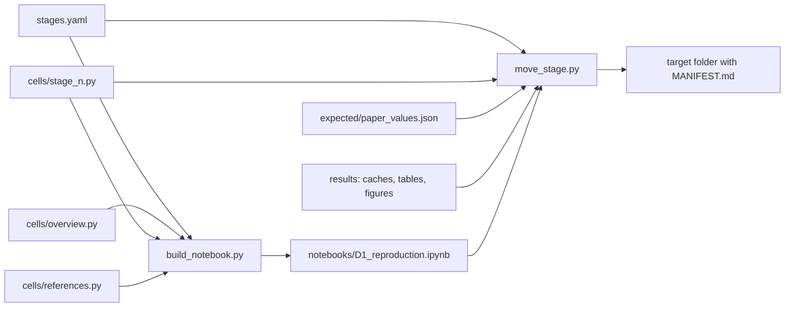

# Architecture

> Japanese version: [architecture.ja.md](architecture.ja.md)

All of the analysis code is in the notebook [notebooks/D1_reproduction.ipynb](../notebooks/D1_reproduction.ipynb), so that every number can be audited in one place. The notebook is generated from the cell modules in [scripts/cells/](../scripts/cells), which are the files to edit, by [scripts/build_notebook.py](../scripts/build_notebook.py) in the order of [stages.yaml](../stages.yaml). The package `lichess_d1` keeps only what is not analysis: where the data are, the plotting style, and the command that executes the notebook.

## Files

| File | Responsibility |
|---|---|
| `scripts/cells/overview.py`, `stage_<n>.py`, `references.py` | Source of the notebook: every markdown cell (Japanese only) and every code cell (English only), as a list `CELLS`. Each stage module's docstring lists the names it uses from earlier steps |
| `scripts/cells/common.py` | The cell constructors `md()` and `code()`, and the `self-contained` tag |
| `stages.yaml` | The steps in notebook order (see below) |
| `scripts/build_notebook.py` | Joins the overview, the stage modules in `stages.yaml` order and the references into the notebook. `--execute` also runs it |
| `scripts/stage_list.py` | Reads `stages.yaml` (`Stage`, `load_stages()`) for the two scripts below |
| `scripts/move_stage.py` | Copies one step with its files to another folder, or moves it out (see below) |
| `notebooks/D1_reproduction.ipynb` | The generated, executed notebook: all analysis code with its outputs |
| `src/lichess_d1/config.py` | Data locations (`D1_*` environment variables), the notebook path, the expected-values path |
| `src/lichess_d1/plotting.py` | Figure style: fixed palette, recessive axes, `new_figure`, `save_figure` |
| `src/lichess_d1/cli.py` | `d1 run [--refresh]`: executes the notebook in place |
| `tests/test_notebook.py` | Runs the notebook's self-contained cells; checks that every printed number was reproduced |
| `tests/test_move_stage.py` | Tests `move_stage.py` on a made-up repository layout; checks that each stage module lists the names it uses from earlier steps |
| `expected/paper_values.json` | Every number printed in the paper and where it sits in `summary` |

## Steps (`stages.yaml`)

Each entry of `stages.yaml` is one step of the notebook, in order:

| Key | Meaning |
|---|---|
| `id` | Step number, as in the notebook's headings |
| `title_ja` | Heading of the step in the notebook |
| `module` | Its cell module, `scripts/cells/stage_<n>.py` |
| `questions` | Question ids it answers (`Q2a`, ...) |
| `caches` | Globs of its saved fits in `results/cache` |
| `results` | Globs of its tables in `results` |
| `figures` | Globs of its figures in `results/figures` |
| `summary_key` | Its key in `summary.json`, or null |
| `expected_prefix` | Path prefix of its numbers in `expected/paper_values.json`, or a list of prefixes (stage 3 also owns the Binscatter's `panel.flexible` paths), or null |



`move_stage.py <id> --to <dir>` copies the executed notebook, the step's module, its expected values (as a `paper_values.json` of the same style), its `stages.yaml` entry and the matching saved fits, tables and figures into `<dir>`, at the same relative paths, and writes `<dir>/MANIFEST.md`: what was copied, from which commit, and how to restore it. `<dir>` must be outside the repository and must not hold any of these files yet. `--dry-run` only prints this plan. `--remove` refuses to run on uncommitted changes; it first tags the current commit as `pre-move-stage<id>-<YYYYMMDD>` (with `-2`, `-3`... if that tag is on another commit) and then removes the files, the expected values, the entry and the module from the repository. The command lists the lines of `README*.md` and `Docs/*.md` that mention the step, and the later steps that use names it defines (found by reading the code cells' scopes); those edits are made by hand.

## Where each analysis is defined in the notebook

The cells of step `<n>` are in `scripts/cells/stage_<n>.py`. Each function is defined just before it is first used. Cells tagged `self-contained` hold definitions only, or definitions plus checks on made-up data whose answer is known; they run without the data.

| Step | Definitions | Checked on made-up data |
|---|---|---|
| 0 Setup | study months, `cached` (saved fits) | the month count |
| 1 Data | `removal_rules`, `analysis_filter`, `add_derived`, `load_bot_accounts`, `load_games`, `load_month`, `elo_expected_score` | the filter and the derived variables |
| 2 Inverted-U test | 2.1 `prepare`, `describe`, `panel_games`; 2.2 `ModelResult`, `tidy`, `to_model_frame`, `fit_fe_lpm`, `peak`; 2.3 `difficulty_row`, `return_targets`, `comparisons`, `horizon_rows`; 2.4 `place_knots`, `cr_basis`, `cr_penalty`, `SmoothFit`, `demean`, `fit_fe_gam`, `flat_top`, `split_at`, `two_slopes`, `robin_hood`, `z_value`, `two_lines_specs`, `two_lines`, `find_spec`, `spec_key`, `spec_label`, `spec_columns`, `control_terms`, `session_ends`, `binned_return`, `wilson_interval`, `two_lines_curve`, `two_lines_row` | within estimator = one dummy per player; peak and its delta-method SE; knots as mgcv places them, a penalty that leaves straight lines alone, a made-up hill recovered by the GAM; flat top, two-lines terms, Robin Hood break, slopes of a made-up kinked curve; session ends and bins; Wilson's interval |
| 3 Asymmetry | 3.1 `es_bin_column`, `flexible_data`, `fit_flexible`, `flexible_curve`, `model_sample`, `add_bins`, `fit_binned`, `gap_of_es`, `made_up_panel`, `spec_short`, `fit_es_bins`, `curve_table`, `plot_bins`, `plot_support`; 3.2 `wald_test`, `linear_combination`, `bin_arrays`, `mirror_test`, `fieller_interval`, `end_ratio`, `made_up_fit`, `mirror_row`, `mirror_rows` | bins of a made-up step curve; zero mirror differences of a symmetric curve, a made-up hard-side drop detected and none found without it, Fieller's interval with an exact denominator |
| 4 Check | `summary` (all numbers), table writing, `resolve`, `agrees`, `compare` | path lookup and the three kinds of comparison |

## Saved fits

`cached(name, compute)` writes each result to `results/cache/<name>.json` as soon as it is computed and reads it back on later runs (git-ignored). Setting `D1_REFRESH=1` (or `d1 run --refresh`) fits everything again.

| Cache file | Contents |
|---|---|
| `binned_<month>.json` | The binned counts of one month |
| `panel_describe.json`, `panel_n_session_ends_7d.json` | Size of the panel sample |
| `panel_horizons.json` | Step 2.3: the nine horizon models |
| `panel_two_lines_<target>_<days>d_<within>_<result>.json` | Step 2.4: one two-lines test per horizon model (and the 7-day model without the result) |
| `panel_two_lines_curve_same_bot_7d_player_<result>.json` | Step 2.4: the GAM of the main model's test (with and without the result) on a grid, drawn in figure 1 |
| `panel_flexible.json` | Step 3.1: the Binscatter of the main model, with and without the result |
| `panel_flexible_<target>_<days>d_<within>_<result>.json` | Step 3.1: the Binscatter of each of the ten models, with the bins' covariance and sessions |

`<model>` is a model name such as `same_bot_7d_player_result`. If an analysis function changes, delete its cache files (or refit everything); otherwise the saved fit stays stale.

## One run

```mermaid
sequenceDiagram
    participant U as d1 run / build_notebook --execute
    participant N as notebook kernel
    participant C as results/cache
    participant D as data (Parquet)
    U->>N: execute every cell
    N->>N: self-contained cells: define functions, run checks on made-up data
    loop 49 months (step 2, raw curve)
        N->>C: binned_<month>.json?
        alt not saved
            N->>D: load_month (filter, derived variables)
            N->>N: fit
            N->>C: write
        end
    end
    loop panel analyses (steps 2 and 3)
        N->>C: panel_<name>.json?
        alt not saved
            N->>D: panel_games (read once)
            N->>N: fit
            N->>C: write
        end
    end
    N->>N: draw figures, build summary
    N->>N: write results/*.csv, summary.json; compare with expected/paper_values.json
    N-->>U: executed notebook with outputs
```

## Outputs (`results/`)

| File | Contents |
|---|---|
| `summary.json` | Every number of the paper (panel fits, Binscatter, two-lines test; step 3 under `shape`) |
| `return_by_es_bin.csv` | Raw 7-day return by expected-score bin, all months |
| `panel_horizons.csv`, `panel_flexible.csv`, `panel_two_lines.csv` | Panel fits |
| `shape_*.csv` | Step 3 tables: Binscatters of the ten models (`shape_flexible.csv`), mirror tests (`shape_mirror.csv`, `shape_mirror_pairs.csv`) |
| `comparison.csv` | Printed vs recomputed number, and whether they agree |
| `figures/*.png` | The paper's figures: `d1_return_raw.png` (1: raw rate), `d1_binscatter_models.png` (2: Base by horizon and 7-day models by comparison), `d1_mirror.png` (3: Base7 folded at an even game); supporting `d1_return_curve.png` (raw rate and two lines), `d1_horizons.png`, `d1_binscatter.png` (main model with and without the result), `d1_flexible_all.png` |
